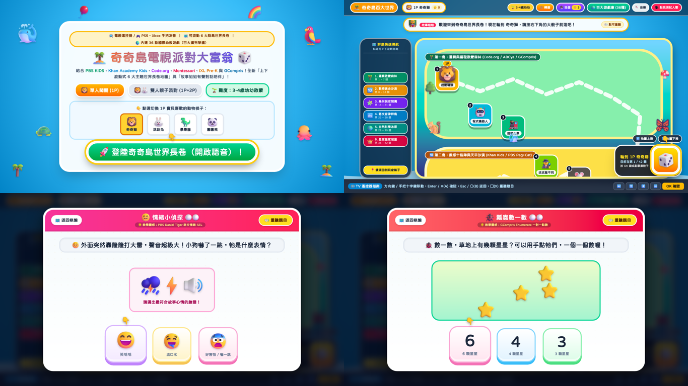
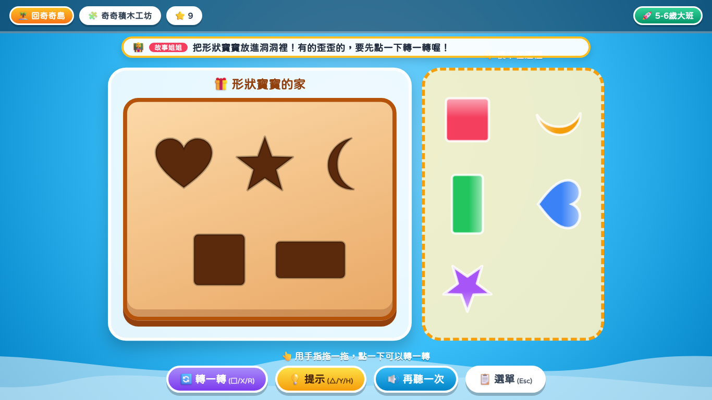

# 🏝️ 奇奇島電視派對大富翁

給 **3 歲以上小朋友** 的益智闖關遊戲。打開網頁就能玩，電視、平板、電腦都可以，用電視遙控器或遊戲手把操作。

👉 **立即遊玩：https://pitty0574.github.io/qiqi-island-party/**

🧩 **新！奇奇積木工坊：https://pitty0574.github.io/qiqi-island-party/blocks/**

## 特色

- 🎲 **大富翁闖關地圖**：6 座主題島嶼、42 個關卡格子，擲骰子前進
- 🧩 **36 款益智小遊戲**：數數、顏色、形狀、規律、迷宮、記憶、方位、時鐘、自然發音……
- 🌱 **兩種難度**：3–4 歲幼幼（每關 2 題、選項較少）／ 5–6 歲大班（每關 3 題）
- 💛 **答錯不懲罰**：選錯的選項會收起來，最後一定能答對（參考 GCompris 的溫和設計）
- 🗣️ **故事姐姐語音**：瀏覽器內建語音，或 Azure 台灣國語真人語音（曉臻／曉雨／雲哲）
- 🎮 **電視友善操作**：遙控器方向鍵＋OK，或 PS5 / Xbox 手把
- 🔮 **獎勵系統**：星星、扭蛋貼紙收藏、幸運轉盤、過關小劇場

## 🧩 奇奇積木工坊（空間概念）

動手拖一拖、轉一轉、拼一拼的空間概念小遊戲，所有關卡都能用手指、滑鼠、遙控器或手把操作。

| 關卡 | 練習什麼 | 幼幼（3-4 歲） | 大班（5-6 歲） |
|---|---|---|---|
| 🔺 形狀投入箱 | 形狀辨識、對準方向 | 3 個形狀，不用轉 | 5 個形狀，要先轉對方向 |
| 🦁 動物拼圖 | 部分與整體、位置關係 | 4 片，參考圖較清楚 | 9 片，參考圖很淡 |
| 🏠 寶寶七巧板 | 形狀組合、空間拼合 | 2–3 塊，影子有虛線分隔 | 3–5 塊，要旋轉、無分隔線 |

遙控器 / 手把：十字鍵選積木 → ✕/OK 拿起來 → 十字鍵移到洞上 → □/R 轉一轉 → ✕/OK 放下（○/Esc 放回去）。

## 操作方式

| 動作 | 鍵盤 / 遙控器 | 手把 |
|---|---|---|
| 移動選擇 | 方向鍵 | 十字鍵 / 左搖桿 |
| 確認 | Enter / OK | ✕ (A) |
| 返回 | Esc / 返回鍵 | ○ (B) |
| 重聽題目 | — | □ (X) |
| 開始 / 擲骰子 | — | OPTIONS / START |

## 雲端真人語音設定（選用）

1. 在 Azure 入口網站建立「語音服務」，定價層選 **Free F0**（每月 50 萬字免費，用完只會暫停）
2. 遊戲右上角 🗣️ →「☁️ 雲端真人語音」→ 貼上金鑰、選區域 →「儲存並試聽」

金鑰只存在該裝置的瀏覽器裡，**不會**寫進遊戲檔案。

## 使用的開源資源

- [Microsoft Fluent Emoji 3D](https://github.com/lobehub/fluent-emoji)（MIT）— 3D 立體圖示
- [粉圓體 Huninn](https://github.com/justfont/Huninn)（OFL）— 圓體中文字型
- [Tailwind CSS](https://tailwindcss.com)（MIT）
- 教學設計參考：[GCompris](https://gcompris.net)、PBS KIDS、Khan Academy Kids 等

## 更新紀錄

- **積木工坊 v1**（2026-11）：形狀投入箱、動物拼圖、寶寶七巧板（參考 GCompris Complete the puzzle / Baby tangram）

- **v5**（2026-11）：Fluent 3D 圖示、粉圓體、海浪泡泡動畫、島嶼裝飾、糖果色按鈕
- **v4**：Azure 雲端真人語音、聲音檢查
- **v3**：36 款遊戲、6 島長卷地圖、過關小劇場
- **v2**：GCompris 式難度與溫和回饋、手把支援、存檔
